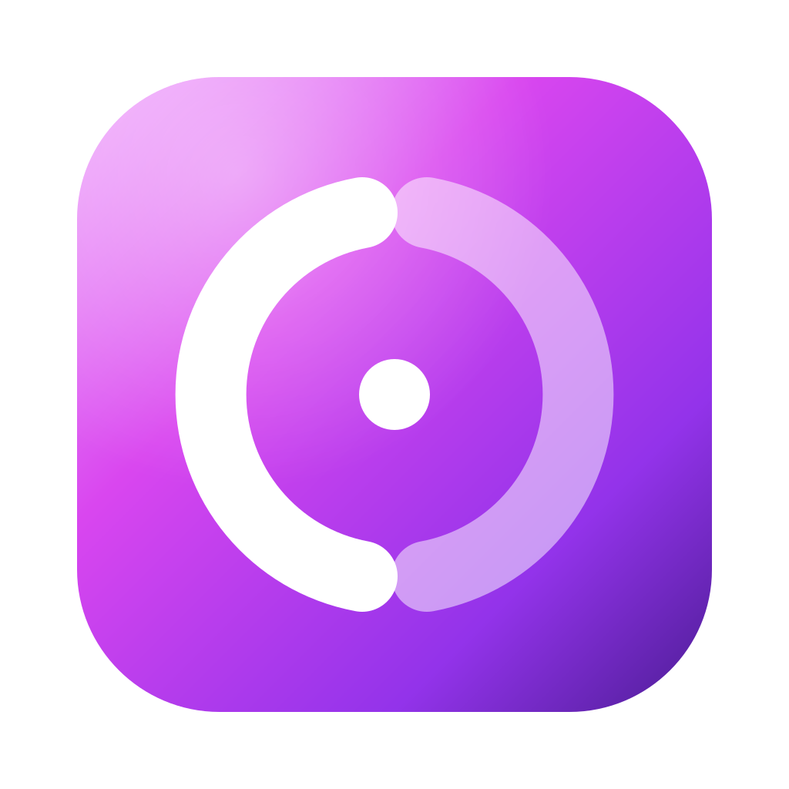

<p align="center"></p>

<h1 align="center">Openergy</h1>

<p align="center">One keyboard and mouse for all your computers.<br>
A small, fast, open-source replacement for Synergy — and it talks to Synergy.</p>

---

Openergy shares one keyboard, mouse and clipboard between computers on your network.
Move the pointer off the edge of one screen and it appears on the next computer.
Copy on one computer and paste on another.

It speaks the classic Synergy wire protocol (Synergy 1.8, as used by Synergy 3,
Deskflow, Barrier and Input Leap), so you can replace Synergy one computer at a time.

## Why

Synergy 3 works, but it is heavy and it has rough edges. Openergy keeps what is good
and fixes the rest.

| | Synergy 3.7 | Openergy |
|---|---|---|
| Installed size | 523 MB (Electron, Qt, Node) | 5.8 MB (native, signed) |
| Memory with the window closed | about 144 MB (service, tray, core) | about 69 MB (app ~59 MB, daemon ~9.3 MB) |
| Idle CPU | — | 0.03% (daemon, 60 s) |
| Added input latency | — | 0.18 ms p99, capture to injection |
| macOS 27: click an inactive window | the window does not come to the front | numbered synthetic clicks, like a real mouse |
| Large clipboard items | dropped without notice over 4 MB | up to 64 MB by default, sent in the background; you see a notice when the other computer refuses |
| Reconnect after a network blip | can loop on "already connected" | replaces the stale connection |
| TLS trust | fingerprint check off by default, key file world-readable | fingerprints always pinned, key file `0600` |
| Account, licence, telemetry | required, Sentry | none |

## The macOS 27 focus fix

On macOS 27, Synergy's synthetic clicks reach the button under the pointer but do not
bring an inactive window to the front. Only a click on the title bar works. The cause:
macOS now expects every synthetic click to carry its own increasing mouse event number
(`kCGMouseEventNumber`), shared by the matching drag and mouse-up events. Openergy's
injector sets these numbers, so the window server activates windows exactly as it does
for a real mouse. No helper app, no guessing which window is under the pointer, and
menu-bar menus behave normally. Details: [docs/focus-fix.md](docs/focus-fix.md).

## Install (macOS)

Openergy needs macOS 15 or later. Building needs Xcode (Swift 6) and Rust (`rustup`).

```sh
git clone https://github.com/SergeSerb2/openergy && cd openergy
apps/macos/scripts/bundle.sh          # builds dist/Openergy.app
open dist/Openergy.app
```

On first launch, Openergy asks for two macOS permissions:

- **Accessibility** — to move the pointer and type on this Mac.
- **Input Monitoring** — to send this Mac's keyboard and mouse to other computers
  (needed only when this Mac hosts).

The permission page updates by itself when you switch each one on.

## Use

The menu-bar icon shows the state: both halves bright means connected.

- **Host** — this Mac's keyboard and mouse control the other computers.
  Arrange the screens in the Layout window: drag them so their edges touch.
- **Join** — this Mac is controlled by another computer's keyboard and mouse.
  Enter the server address (for example `192.168.1.20`) or pick a computer under Nearby.

### Moving from Synergy

Openergy can read your Synergy 3 settings (layout, server address, clipboard and TLS
options) and leaves the Synergy files unchanged:

- In the app: **Connection → Import Settings from Synergy…**
- Or: `openergy import-synergy --from ~/Library/Preferences/Synergy`

To connect to a Synergy **server**, choose Join and enter its address. Compare the
fingerprint the app shows with the one in Synergy, then trust it. Synergy servers do
not check client certificates by default. If yours does (`checkPeerFingerprints`), add
this Mac's line (below) to the server's `trusted-clients` file; on Windows that is
`C:\ProgramData\Synergy\tls\trusted-clients`.

When an Openergy **server** accepts a Synergy **client**, the Synergy client must trust
Openergy's certificate. Print the line it expects and add it to the client's
`trusted-servers` file: `tls/trusted-servers` beside Synergy's settings on macOS,
`C:\ProgramData\Synergy\tls\trusted-servers` on Windows.

```sh
openergy fingerprint --synergy      # prints v2:sha256:<64 hex characters>
```

## Command line

The same `openergy` binary runs headless, which is how Linux and servers use it.

```text
openergy daemon [--config <file>] [--platform macos|x11|windows|virtual]
openergy server | client [--remote host:port]
openergy status | connect | disconnect | restart
openergy ctl <method> [--json '{…}']        # raw control API
openergy trust list | approve <fp> | revoke <fp> | import-synergy <dir>
openergy fingerprint [--synergy]
openergy import-synergy [--from <dir>] [--out config.toml]
openergy export-synergy-conf [--out synergy.conf]
```

Configuration lives in `~/Library/Application Support/Openergy/config.toml` on macOS,
`$XDG_CONFIG_HOME/openergy/config.toml` on Linux, and `%APPDATA%\Openergy\config.toml` on Windows.
Windows control commands use a private per-user named pipe. `--socket` selects
a separate pipe for a lab or a second configuration; use the same value on the daemon and CLI.

## Platforms

| Platform | Status |
|---|---|
| macOS 15+ | Main platform. Native app plus daemon. |
| Linux (X11) | Daemon with a native X11 backend, tested on Xvfb (capture, injection, clipboard). |
| Windows | Headless daemon and CLI with private named-pipe control. Native backend starts in session 0; desktop input acceptance is pending. [Verification](docs/verification/windows-daemon-2026-10-21/README.md). |
| Linux (Wayland) | Not yet. |

Known v1 limits are listed in [crates/config/V1-LIMITS.md](crates/config/V1-LIMITS.md): keyboard-language
sync, half-duplex lock keys, and modifier remapping of key IDs are not implemented yet.

## How it is built

- **Engine:** one Rust daemon, no async runtime: a few dedicated threads and one
  `mio` event loop. TLS with `rustls`. Mouse moves are coalesced and keyboard and mouse
  frames always go before clipboard data, so typing never waits behind a large paste.
- **Safety:** one release path for every way a screen can be left (leave, disconnect,
  timeout, sleep, crash of the peer), so keys and buttons are never left pressed.
- **macOS app:** SwiftUI menu-bar app. It starts the daemon as a child process and
  controls it over a private Unix socket with JSON messages.
- **Compatibility:** the wire protocol was documented from the shipping Synergy 3.7
  binaries ([docs/re](docs/re)) and checked against real Deskflow 1.27 and Barrier 2.4
  peers in an isolated Docker lab ([tools/interop-lab](tools/interop-lab)), and against
  the Synergy 1.21.1 core on Windows ([tools/windows-lab](tools/windows-lab)).

More: [architecture](docs/plan/architecture-r2.md), [UI contract](docs/plan/ui-contract.md).

## Testing

There are no unit tests by design. Every check runs real binaries over real sockets:

- `openergy-e2e run` — the scenario suite (two daemons with the virtual platform, plus
  Deskflow and Barrier peers in Docker).
- `Openergy --e2e <dir>` — drives the real macOS app logic against a real daemon.
- `tools/focus-lab` — reproduces the macOS 27 focus bug and checks the fix on a test Mac.
- `tools/windows-lab` — runs a private copy of the Synergy core installed on a Windows PC
  against Openergy, without disturbing the Synergy in use there.

## Measurements

Measured on an Apple M5 Pro with macOS 27.2. Full evidence and commands:
[crates/daemon/VERIFICATION.md](crates/daemon/VERIFICATION.md).

| Measure | Result |
|---|---|
| App bundle | 5.8 MB (app 1.2 MB, daemon 3.5 MB, icon 1.1 MB) |
| Daemon memory, idle | 9.3 MB resident |
| Daemon memory after an 8 MiB clipboard transfer | about 19 MB (one retained copy) |
| App memory, window closed | about 59 MB resident (AppKit and SwiftUI) |
| Daemon CPU, idle over 60 s | 0.03% |
| Input latency, capture to injection, 1,000 moves | 0.18 ms p99 |
| Scenario suite (`openergy-e2e`) | 73 of 73 pass |
| Interop with Deskflow 1.27 and Barrier 2.4 (TLS on and off, both roles) | 8 of 8 pass |
| Interop with Synergy core 1.21.1 on Windows (TLS and pinning both ways, both roles, clipboard) | pass, [details](docs/verification/windows-synergy-1.21.1/README.md) |
| App end-to-end (`Openergy --e2e`) | 14 of 14 pass |

The focus fix was checked with `tools/focus-lab` on a macOS 27.0.1 test Mac: numbered clicks
pass all seven scenarios (activation, first click, title-bar drag, menu-bar menus, double-click).
On 27.0.1 the original bug does not reproduce, so the final check belongs on macOS 27.2:
[docs/verification/focus-lab-macos-27.0.1](docs/verification/focus-lab-macos-27.0.1/README.md).

## Licence

MIT or Apache-2.0, at your option. Openergy is an independent implementation. It
contains no Synergy or Deskflow code. "Synergy" is a trademark of Symless Ltd.
