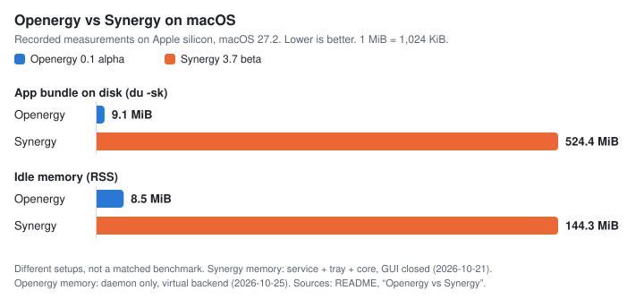

<p align="center"></p>

<h1 align="center">Openergy</h1>

<p align="center">Share one keyboard, mouse, and clipboard across computers on your local network.</p>

Openergy is an open-source, lightweight replacement for Synergy. It has a Rust
daemon and CLI, a native SwiftUI menu-bar app for macOS, and headless daemons
for Windows and Linux X11. One computer hosts the keyboard and mouse; the
others join it. A screen layout decides where the pointer crosses over.
Clipboard sharing supports text, HTML, and images. Openergy speaks the classic
Synergy-family protocol, so it can also work with Deskflow, Barrier, and
Synergy peers.

> [!WARNING]
> **Alpha software, version 0.1.0.** No release has been published yet.
> Configuration and packaging can still change. Keep another way to control
> each computer while you try it. [Readiness](docs/plan/readiness.md) lists
> what has been verified and what has not.

## Platform status

| Platform | Status |
| --- | --- |
| macOS 15+ | Main platform: menu-bar app and daemon. Native input and window focus still need wider desktop testing. |
| Windows | Headless daemon and CLI. Named-pipe control and virtual TLS peers are verified. Interactive desktop input, clipboard, and mixed DPI are not yet verified. |
| Linux X11 | Headless daemon with capture, injection, and clipboard. Tested in an isolated Xvfb server only. |
| Linux Wayland | Not supported. |

Windows and Linux have no graphical app and no automatic updates. Report bugs
in [GitHub issues](https://github.com/SergeSerb2/openergy/issues). For
sensitive reports, read [SECURITY.md](SECURITY.md) first.

## Openergy vs Synergy

<picture>
  <source media="(prefers-color-scheme: dark)" srcset="assets/openergy-vs-synergy-dark.svg">
  
</picture>

| macOS, Apple silicon | Synergy 3.7.0-beta | Openergy 0.1.0 alpha |
| --- | --- | --- |
| App bundle on disk (`du -sk`) | 524.4 MiB (536,936 KiB) | 9.1 MiB (9,276 KiB) <!-- fresh: bundle-size --> |
| Regular-file bytes in the bundle | 548,821,397 | 9,286,302 in 95 files <!-- fresh: bundle-bytes --> |
| Idle memory (RSS) | 143.6–144.3 MiB for service, tray, and core, main window closed | 8.47 MiB for the daemon, server role, virtual backend <!-- fresh: idle-rss --> |
| Idle CPU | 0.0% in each process (rounded `ps` readings) | 0.0% over 60 s <!-- fresh: idle-cpu --> |
| Built with | Electron UI, Rust tray, Qt core | SwiftUI app, Rust daemon |
| Measured | 2026-10-21, macOS 27.2, three `ps` samples, Synergy connected as a client. [Source](docs/re/04-tray-security-packaging.md#g-resource-baseline-and-launch-time-work) | 2026-10-25, Apple M5 Pro, macOS 27.2, arm64 build. [Source](docs/plan/readiness.md#latest-verification-run) <!-- fresh: measured --> |

These numbers come from different setups, so they are not a matched
benchmark. The Synergy memory figure includes its menu-bar tray. The Openergy
figure covers only the daemon; the menu-bar app adds its own memory, which was
not measured here. No input-latency comparison has been made. The chart is
generated from [tools/comparison-chart](tools/comparison-chart/chart.py).

## Build and set up on macOS

You need macOS 15 or later, Git, Rust with Cargo, Xcode or the Apple command
line tools (Swift 6 and the macOS SDK), and Python 3.11 or later for packaging.
The build fetches dependencies from the network.

```sh
git clone https://github.com/SergeSerb2/openergy.git
cd openergy
export PATH="$HOME/.cargo/bin:$PATH"
PYTHON=python3 OPENERGY_SIGN_IDENTITY=- CARGO_BUILD_JOBS=2 nice -n 15 apps/macos/scripts/bundle.sh
```

This builds `dist/Openergy.app` for your Mac's architecture, with a local
ad-hoc signature (`-`). It is not notarized. For other architectures and
release packaging, see [releasing](docs/releasing.md).

Open `dist/Openergy.app` on each Mac you want to share. Do not try it in an
account whose keyboard and mouse already depend on another sharing tool.

1. Open **Permissions**. Joining needs Accessibility. Hosting also needs Input
   Monitoring. A rebuild or signing change can require granting them again.
2. On the computer with the keyboard and mouse, choose **Host**. In **Layout**,
   add each client's screen name and place it next to the host. Names must
   match exactly, and edges must touch.
3. On each other Mac, choose **Join** and enter the host's address and port.
   **Nearby** only shows discovered computers; it does not prove who they are.
4. Compare the certificate fingerprint on both computers through a channel you
   trust, then approve. Never approve a fingerprint you did not expect.
5. Check that the app shows a connected, trusted peer with TLS on. Try a text
   copy, a screen crossing, and a disconnect. Then turn on
   **Settings → Open at login** if you want it.

For the CLI, Linux, Windows, trust commands, recovery, and moving from Synergy,
see the [setup guide](docs/plan/setup.md). It links full
[server](examples/server.toml) and [client](examples/client.toml) examples.

## Trust and privacy

TLS is on by default. Clients pin the server's certificate, and servers accept
only clients they trust (`tls.require_client_trust = true`). These are local
SHA-256 pins, not certificate-authority checks, so verify the first
fingerprint yourself. Turning TLS off exposes input and clipboard traffic.

A trusted host can send input to every computer that joined it. Clipboard
sharing is on by default, with a 64 MiB local limit, and can copy sensitive
data between computers. Turn it off, or limit its direction, when that is not
wanted. File transfer and drag-and-drop are not supported. More limits:
[V1-LIMITS.md](crates/config/V1-LIMITS.md).

Openergy has no accounts, telemetry, or cloud relay. It uses your local network
and mDNS discovery. Its logs stay on your computer and can contain peer names,
addresses, and fingerprints, so redact them before sharing.
[SECURITY.md](SECURITY.md) describes the threat model and how to report issues.

## Compatibility

These peers were tested on 2026-10-21:

- Deskflow 1.27 and Barrier 2.4, both roles, TLS and plaintext, in an isolated
  Docker lab: [interop lab](tools/interop-lab/README.md).
- Synergy core 1.21.1-beta (protocol 1.8) on Windows, both roles, TLS and
  clipboard, in a non-desktop session:
  [record](docs/verification/windows-synergy-1.21.1/README.md).
- The Openergy Windows daemon with virtual TLS peers:
  [record](docs/verification/windows-daemon-2026-10-21/README.md).

Other versions and Input Leap may work but are untested. The macOS app numbers
its synthetic clicks to fix a window-focus problem seen with Synergy on
macOS 27. A focus lab on macOS 27.0.1 passed, but the problem did not occur
there, so the fix is not yet confirmed on 27.2. See
[focus behavior](docs/focus-fix.md).

## Updates

The macOS app checks for updates with Sparkle. The
[update channel](https://openergy-updates.sergeserbinenko.com/index.html) is
live but empty. The maintainer has Developer ID signing and notarization set
up; no release has been published yet. The
[macOS update workflow](docs/macos-updates.md) describes how update archives are
prepared.

## Development

- [Contributing and safe verification](CONTRIBUTING.md)
- [Documentation map](docs/plan/README.md) and [verification records](docs/verification/README.md)
- [External E2E runner](tools/e2e/README.md)
- [Maintainer release steps](docs/releasing.md)
- [Changelog](CHANGELOG.md), [security policy](SECURITY.md), and
  [code of conduct](CODE_OF_CONDUCT.md)

## License

Dual licensed under [MIT](LICENSE-MIT) or [Apache-2.0](LICENSE-APACHE), at your
option. Dependencies keep their own terms; see
[THIRD_PARTY_NOTICES.md](THIRD_PARTY_NOTICES.md). Openergy is an independent
project based on interoperability research ([docs/re](docs/re)). It is not
endorsed by the projects or vendors named here.
